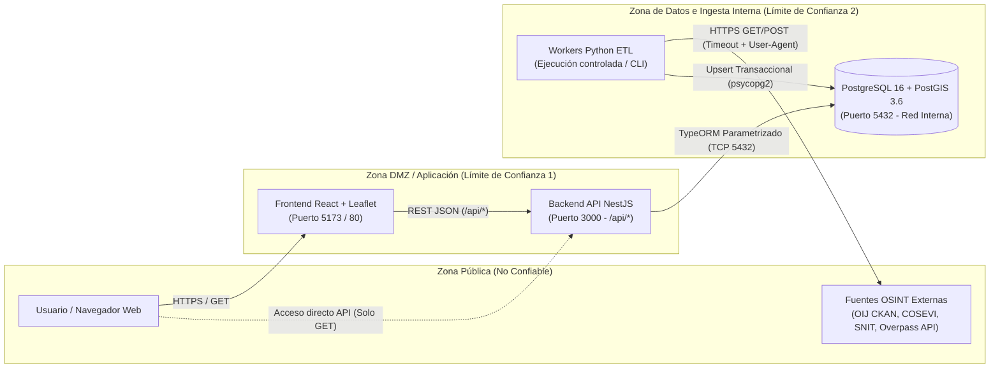

# Base de Conocimiento de Seguridad (KB) — Etapa 1: Planificación SSDLC

> **Proyecto:** Observatorio de Seguridad Vial y Urbana de Costa Rica (`proyecto-seguridad`)  
> **Versión:** `1.0.0` · **Última actualización:** `2026-11-10`  
> **Responsables de Etapa 1:**  
> - **Ítems `1.1`, `1.2`, `1.7` (Flujos críticos, arquitectura de acceso y versionado KB):** Jose Picado (`Jose-Picado-Zamora`) — Revisor: Roberto (`RobertoUNA`)  
> - **Ítem `1.3` (Modelado de amenazas STRIDE en OWASP Threat Dragon):** Billy Ugalde (`Billy-Ugalde`) — Revisor: Jose (`Jose-Picado-Zamora`)  
> - **Ítems `1.4`, `1.5` (Plan de tratamiento de amenazas, terceros, lockfiles y secretos):** Roberto (`RobertoUNA`) — Revisor: Brandon (`Brandon-Corrales`)

---

## 1. Flujos Críticos Seleccionados (`Ítem 1.1`)

Se seleccionan tres flujos críticos del sistema por el impacto que un fallo de integridad, disponibilidad o confidencialidad tendría sobre la toma de decisiones de emergencia vial/urbana y sobre la infraestructura del observatorio:

| ID Flujo | Nombre del Flujo | Actor(es) | Componentes que Atraviesa | Importancia / Impacto de un Fallo |
| :--- | :--- | :--- | :--- | :--- |
| **`FLOW-01`** | **Cruce Geoespacial y Panorama Cantonal** (`GET /api/cantones/:id/panorama`) | Ciudadano / Analista (Público sin sesión) | `Frontend React` → `CruceController` → `CruceService` → `PostgreSQL/PostGIS` (`canton`, `delito`, `accidente`, `infraestructura`) | Es la propuesta de valor central del sistema. Un cálculo erróneo del `indice_cobertura` o una inyección en el parámetro `:id` distorsiona la priorización de vulnerabilidad territorial o indispone la base de datos. |
| **`FLOW-02`** | **Consulta Multicapa con Filtros Dinámicos** (`GET /api/delitos`, `/api/accidentes`, `/api/infraestructura`) | Ciudadano / Analista (Público sin sesión) | `Frontend FilterPanel` → `OijController` / `CoseviController` / `OsmController` → `PostgreSQL/PostGIS` | Recibe múltiples parámetros externos (`canton`, `tipo`, `clase`, `anio`, `desde`, `hasta`). La ausencia de cotas (`LIMIT`) o de validación de tipos/fechas puede causar denegación de servicio (DoS) o errores 500 con fuga de estructura interna. |
| **`FLOW-03`** | **Ingesta y Normalización de Fuentes OSINT** (`workers/{snit,oij,cosevi,osm}/fetch_*.py` + `/api/health`) | Operador / Proceso Batch Automatizado | `Workers Python` → `APIs Públicas OSINT` (`OIJ`, `COSEVI`, `SNIT`, `Overpass`) → `PostgreSQL/PostGIS` | Cruza la frontera de confianza hacia servicios externos públicos y escribe directamente en la base de datos usando credenciales privilegiadas (`DB_PASSWORD`). Una respuesta corrupta, un cambio de esquema o un bloqueo por rate-limit compromete los datos o deja el servicio sin actualizar. |

### Criterios de Aceptación `Dado / Cuando / Entonces` por Flujo

#### `FLOW-01`: Cruce Geoespacial y Panorama Cantonal (`GET /api/cantones/:id/panorama`)
- **Éxito:** **Dado** que existen cantones y registros OSINT cargados en PostGIS, **cuando** un usuario consulta `GET /api/cantones/101/panorama` (o por nombre `SAN JOSE`), **entonces** el backend responde `200 OK` con un GeoJSON `Feature` que incluye totales de delitos, accidentes, infraestructura, el percentil `indice_cobertura` (`0..100`), `indice_cobertura_ratio` y las cabeceras `X-Data-Source` y `X-Fetch-Date`.
- **Error controlado:** **Dado** un código o nombre de cantón inexistente (ej. `999999`), **cuando** se consulta `GET /api/cantones/999999/panorama`, **entonces** el backend responde `404 Not Found` con mensaje claro sin exponer trazas de pila ni consultas SQL.
- **Uso indebido / Abuso:** **Dado** un intento de inyección o manipulación en `:id` (ej. `101' OR '1'='1`), **cuando** la solicitud llega al backend, **entonces** la consulta parametrizada de TypeORM neutraliza el payload, responde `404 Not Found` sin alterar ni exponer registros adicionales, y el evento queda registrado en el log de seguridad.

#### `FLOW-02`: Consulta Multicapa con Filtros Dinámicos (`GET /api/delitos`, `/api/accidentes`, `/api/infraestructura`)
- **Éxito:** **Dado** un rango de fechas válido (`desde=2023-01-01&hasta=2023-12-31`) y un cantón existente, **cuando** se consulta `GET /api/delitos`, **entonces** el backend devuelve hasta el límite máximo permitido (`1000` para series temporales, `5000` para infraestructura) junto con la atribución `fuente` y `fecha_obtencion`.
- **Error controlado:** **Dado** un rango invertido (`desde=2025-01-01&hasta=2020-01-01`) o fecha malformada (`desde=no-es-fecha`), **cuando** se consulta `GET /api/delitos`, **entonces** el servicio rechaza la petición con `400 Bad Request` antes de consultar PostgreSQL.
- **Uso indebido / Abuso:** **Dado** un cliente que intenta extraer masivamente toda la base o enviar parámetros fuera de dominio (`anio=99999` o payloads SQL en `tipo`), **cuando** el backend procesa la solicitud, **entonces** aplica consultas parametrizadas y truncamiento obligatorio (`.limit(1000)` / `.take(5000)`), impidiendo el agotamiento de memoria.

#### `FLOW-03`: Ingesta y Normalización de Fuentes OSINT (`workers/*/fetch_*.py`)
- **Éxito:** **Dado** que la fuente externa (CKAN OIJ, CSV COSEVI, ArcGIS SNIT u Overpass API) responde dentro del timeout con las columnas requeridas, **cuando** se ejecuta el worker de ingesta, **entonces** los registros se normalizan, se vinculan al `canton_id` oficial y se insertan/actualizan de forma idempotente registrando `fuente` y `fecha_obtencion`.
- **Error controlado:** **Dado** que Overpass API o el portal de COSEVI devuelve timeout, HTTP `429` o `503`, **cuando** el worker ejecuta la descarga, **entonces** aplica backoff exponencial (máx. 3 intentos, fallback al mirror `overpass.kumi.systems` en OSM) y, si persiste el fallo, aborta sin borrar ni corromper los datos previamente almacenados en PostgreSQL.
- **Uso indebido / Abuso:** **Dado** un archivo CSV externo alterado que no contiene las columnas obligatorias (`CLASE DE ACCIDENTE`, `TIPO DE ACCIDENTE`, `ANO`, `CANTON`) o contiene años fuera de rango (`< 1900` o `> 2100`), **cuando** el worker valida la entrada, **entonces** rechaza el lote o descarta las filas inválidas antes de abrir transacción en la base de datos.

---

## 2. Mapa Mínimo de Arquitectura, Límites de Confianza y Control de Acceso (`Ítem 1.2`)

### Clasificación de Datos Protegidos y Consecuencias de Impacto

| Dato / Activo | Sensibilidad | Consecuencia de Exposición (Confidencialidad) | Consecuencia de Modificación (Integridad) | Consecuencia de Pérdida (Disponibilidad) |
| :--- | :---: | :--- | :--- | :--- |
| **Credenciales de BD (`DB_PASSWORD`)** | **Crítica** | Acceso directo al motor PostgreSQL y toma de control de los datos. | Alteración o borrado total de las 4 tablas OSINT (`DROP`/`TRUNCATE`). | Bloqueo del backend y de los workers de ingesta. |
| **Datos agregados OSINT (`canton`, `delito`, `accidente`, `infraestructura`)** | **Media (Integridad Crítica)** | Datos públicos agregados (sin PII individual por diseño ético). | Falsificación del `indice_cobertura`, induciendo errores en análisis de vulnerabilidad cantonal. | El mapa interactivo y el endpoint `/panorama` dejan de funcionar. |
| **Credenciales de CI/CD y Publicación (`DOCKERHUB_TOKEN`, `GITHUB_TOKEN`)** | **Crítica** | Suplantación de identidad del pipeline y lectura de configuración. | Publicación de imágenes Docker maliciosas (compromiso de cadena de suministro). | Interrupción del pipeline de integración y despliegue continuo. |
| **Registros de auditoría y eventos de seguridad (Logs)** | **Alta** | Si no se sanitizan, podrían filtrar rutas internas o secretos enviados por error. | Ocultamiento de intentos de ataque o escaneo contra la API. | Imposibilidad de investigar incidentes en la Etapa 7. |

### Matriz de Control de Acceso (`Actor/Rol → Recurso → Acción → Condición`)

| Actor / Rol | Recurso | Acción | Condición de Acceso y Permisos |
| :--- | :--- | :--- | :--- |
| **Usuario Anónimo (Sin sesión)** | `GET /api/cantones`, `/api/delitos`, `/api/accidentes`, `/api/infraestructura`, `/api/cantones/:id/panorama`, `/api/health` | `READ` (Consulta) | **Permitido** únicamente vía métodos `GET` de solo lectura, sujeto a validación de filtros (`ValidationPipe` / validadores de servicio) y límites máximos de paginación/truncamiento (`1000` / `5000`). |
| **Usuario Anónimo (Sin sesión)** | Cualquier ruta `POST`, `PUT`, `PATCH`, `DELETE` en `/api/*` o acceso directo al puerto `5432` | `WRITE / DELETE` | **Denegado estrictamente** (`404 Not Found` / `405 Method Not Allowed` en API; puerto `5432` aislado en red interna de contenedores). La API pública no expone endpoints de mutación. |
| **Navegador Web (Frontend)** | Fuentes externas (`datosabiertospj`, `datosabiertos.csv`, `snitcr`, `overpass-api.de`) | `FETCH` directo | **Prohibido por arquitectura**. El frontend solo consume `/api/*` del backend propio. |
| **Backend NestJS (`seguridad_vial`)** | Tablas `canton`, `delito`, `accidente`, `infraestructura` en `seguridad_vial_db` | `SELECT` | **Permitido** con credenciales de entorno (`DB_USER`/`DB_PASSWORD`), sin `synchronize: true` en TypeORM para impedir alteraciones automáticas de esquema en ejecución. |
| **Workers Python ETL** | Tablas `canton`, `delito`, `accidente`, `infraestructura` | `INSERT / UPDATE (Upsert)` | **Permitido** únicamente desde ejecución administrativa local o job programado con acceso a `.env`, previa validación de columnas y tipos del dataset OSINT. |
| **Agente de IA / Desarrollador** | Ramas `main` y `development`, workflows `.github/workflows/*`, reglas `.semgrep.yml`, `.gitleaks.toml` | `PUSH / MERGE` | **Restringido**. Requiere Pull Request, ejecución exitosa de todos los checks obligatorios de CI y aprobación humana de otro integrante del equipo (Revisor). |

---

## 3. Amenazas Priorizadas con STRIDE (`Ítem 1.3`) y Plan de Tratamiento (`Ítem 1.4`)

> **Diagrama y modelo Threat Dragon:** mantenido en [`ThreatDragonModels/STRIDE en Threat Dragon/`](../../ThreatDragonModels/STRIDE%20en%20Threat%20Dragon/STRIDE%20en%20Threat%20Dragon.json) (Responsable `1.3`: Billy Ugalde; modelo inicial creado, pendiente de poblar diagrama y amenazas).  
> **Plan de tratamiento y controles (`1.4`):** mantenido a continuación por Roberto (`RobertoUNA`).

| ID Amenaza | Categoría STRIDE | Flujo / Recurso Afectado | Descripción de la Amenaza e Impacto | Prioridad Justificada | ID Control | Medida Propuesta | Componente Afectado | Comprobación Prevista | Responsable | Estado |
| :--- | :--- | :--- | :--- | :---: | :--- | :--- | :--- | :--- | :---: | :---: |
| **`THR-01`** | **T**ampering / **I**nformation Disclosure | `FLOW-01`, `FLOW-02` (`GET /api/*`) | **Inyección SQL o manipulación de parámetros de consulta (`canton`, `tipo`, `desde`, `hasta`, `:id`)** para alterar la lógica de filtrado o extraer metadatos de PostgreSQL/PostGIS. | **Alta** (Exposición directa a Internet sin sesión) | **`CTL-01`** | 1) Uso obligatorio de parámetros enlazados (`:codigo`, `:tipo`, `:desde`) en `QueryBuilder` de TypeORM. 2) Validación de fechas y tipos antes de ejecutar SQL. 3) Regla SAST en Semgrep (`ssdcl-ts-raw-sql-interpolation`) que prohíbe concatenación o template strings en consultas SQL. | `backend/src/modules/*/*.service.ts` y `.semgrep.yml` | 1) Escaneo Semgrep CE (`2.3` / `3.2`) sin hallazgos en `development`. 2) Pruebas unitarias/integración (`2.2` / `4.3` en PR #7, `4.9` en PR #11) enviando fechas inválidas y payloads SQL (`' OR 1=1--`) verificando respuesta `400`/`404` (pendiente de fusión para pasar a Verificada). | **Roberto** / **Billy** | 🟡 Implementada |
| **`THR-02`** | **D**enial of Service (DoS) | `FLOW-02`, `FLOW-03` (`API` y `Workers Python`) | **Agotamiento de recursos por consultas sin límite o bloqueo indefinido de workers** cuando una fuente OSINT externa no responde o tarda demasiado. | **Alta** (Afecta disponibilidad del mapa y de la BD) | **`CTL-02`** | 1) Limitar resultados en el backend (`.limit(1000)` en delitos/accidentes, `.take(5000)` en infraestructura). 2) Exigir `timeout` explícito en todas las llamadas `requests.get/post` de los workers Python y backoff exponencial con mirror en Overpass. 3) Regla Semgrep (`ssdcl-py-requests-without-timeout`). | `backend/src/modules/*/*.service.ts`, `workers/*/*.py` y `.semgrep.yml` | 1) Regla Semgrep (`3.2`) verifica que ningún `requests.get/post` omita `timeout=`. 2) Smoke test (`6.5`) y pruebas de integración (`4.3`, en PR #7) comprueban respuestas acotadas (pendiente de fusión de PR #7 para pasar a Verificada). | **Roberto** / **Billy** | 🟡 Implementada |
| **`THR-03`** | **I**nformation Disclosure / **S**poofing | Transversal (`FLOW-01..03`, Git y CI/CD) | **Exposición de secretos (`DB_PASSWORD`, tokens de CI/Docker Hub)** en el código fuente, historial de commits, archivos `.env` o artefactos de contenedores. | **Crítica** (Compromete acceso total a BD e imágenes) | **`CTL-03`** | 1) Exclusión de `.env` y `pass.txt` en `.gitignore`. 2) Configuración de **Gitleaks** (`.gitleaks.toml`) y regla Semgrep (`ssdcl-hardcoded-credential-assignment`) en entorno local (`2.3`) y en GitHub Actions (`3.2`). 3) Inyección de secretos vía variables de entorno y GitHub Secrets (`6.4`). | `.gitignore`, `.gitleaks.toml`, `.semgrep.yml`, `.github/workflows/ci.yml` | 1) Demostración con secreto ficticio detectado y bloqueado por Gitleaks (`2.3` y `3.6`). 2) Ejecución limpia de Gitleaks en CI (`exit code 0`). | **Roberto** | 🟢 Verificada |
| **`THR-04`** | **T**ampering (Corrupción de Integridad OSINT) | `FLOW-03` (`workers/cosevi`, `workers/oij`, `workers/snit`, `workers/osm`) | **Envenenamiento o corrupción de datos por cambios en el formato externo** (columnas faltantes en CSV de COSEVI/OIJ, JSON inválido en Overpass o años fuera de rango) o desactivación de verificación TLS (`verify=False`). | **Media-Alta** (Corrompe el índice de vulnerabilidad cantonal) | **`CTL-04`** | 1) Validación estricta de columnas requeridas (`REQUIRED_COLUMNS`), rango de años (`1900..2100`) y tipos antes de insertar, manteniendo transacciones atómicas (`conn.commit()`). 2) Prohibición de `verify=False` en `requests` mediante Semgrep (`ssdcl-py-insecure-ssl-verify-false`). | `workers/cosevi/fetch_accidentes.py`, `workers/*/*.py`, `.semgrep.yml` | 1) Suite unitaria `python -m unittest workers/cosevi/test_fetch_accidentes.py` comprueba rechazo de CSV sin columnas requeridas. 2) Semgrep verifica uso seguro de HTTPS. | **Billy** / **Roberto** | 🟢 Verificada |
| **`THR-05`** | **E**levation of Privilege | Despliegue y Contenedores (`Etapas 3, 5 y 6`) | **Ejecución de contenedores como usuario `root` o en modo `privileged: true`**, o inclusión de paquetes base/dependencias con vulnerabilidades críticas conocidas (CVE). | **Alta** (Permite escape de contenedor o explotación de CVE) | **`CTL-05`** | 1) Políticas automatizadas con **Conftest + OPA/Rego** (`3.4`) que prohíben `privileged: true` y exigen `USER` no-root. 2) Análisis de dependencias con **OSV-Scanner** (`3.2`) y escaneo de imagen + generación de **SBOM** con **Trivy** (`3.3`). | `backend/Dockerfile`, `frontend/Dockerfile`, `policy/container.rego`, `.github/workflows/ci.yml`, `.github/workflows/container-supply-chain.yml` | 1) Ejecución de `conftest test` en `.github/workflows/container-supply-chain.yml` (`3.4`, PR #6). 2) Reportes de OSV-Scanner en `.github/workflows/ci.yml` (`3.2`) y Trivy en `container-supply-chain.yml` (`3.3`, PR #6). | **Brandon** / **Roberto** | 🟡 Implementada |
| **`THR-06`** | **R**epudiation | `FLOW-01`, `FLOW-02` (`API Backend` y `Operación`) | **Falta de trazabilidad ante intentos repetidos de abuso o fallos posteriores al despliegue**, impidiendo detectar ataques o revertir una versión defectuosa a tiempo. | **Media** (Dificulta respuesta a incidentes y recuperación) | **`CTL-06`** | 1) Interceptor de logs de seguridad sanitizados con `correlationId` (`7.2`). 2) Endpoint `/api/health` + smoke tests automatizados (`6.5`) y script de rollback a versión anterior por digest (`6.6`). | `backend/src/modules/health/`, `scripts/smoke-test.ps1`, `scripts/rollback.ps1` | 1) Ejecución de `GET /api/health` y `scripts/smoke-test.ps1` / `.sh` (`6.5`) en CI (`ci.yml` y `deploy-verify.yml`). 2) Logging con `correlationId` (`7.2`/`7.4` en PR #6) y rollback con digests reales pendiente de publicación en Docker Hub (`5.5`) y `deploy/docker-compose.prod.yml` (`6.2`). | **Roberto** / **Brandon** | 🟡 Implementada |

### Política de Riesgos Pospuestos y Excepciones
- Cualquier amenaza o hallazgo cuyo tratamiento se decida posponer temporalmente debe registrarse en el **Registro Único de Hallazgos y Excepciones** (`docs/ssdcl/REGISTRO-HALLAZGOS.md`) indicando: **justificación técnica, responsable que propone, integrante revisor que aprueba el riesgo y fecha de vencimiento/revisión** (nunca posterior a la entrega final sin mitigación compensatoria).

---

## 4. Inventario de Terceros, Dependencias Críticas y Secretos (`Ítem 1.5`)

> **Responsable:** Roberto (`RobertoUNA`) — **Revisor:** Brandon (`Brandon-Corrales`)

### 4.1 Servicios Externos y Fuentes OSINT de Terceros

| ID | Servicio Externo / Tercero | Flujo Asociado | Función en el Proyecto | Datos o Permisos que Recibe | Principales Riesgos | Tratamiento Previsto |
| :--- | :--- | :---: | :--- | :--- | :--- | :--- |
| **`EXT-01`** | **OIJ / Poder Judicial — Datos Abiertos CKAN (Azure Blob)** (`pjcrdatosabiertos.blob.core.windows.net`) | `FLOW-03` | Provee los archivos CSV anuales (2020–2025) de estadísticas policiales por cantón. | Petición `HTTPS GET` anónima desde `workers/oij/fetch_delitos.py`. No recibe credenciales ni datos de usuarios. | Caída temporal del blob, cambio en el orden de las 11 columnas CSV o latencia alta. | Timeout explícito de `120s`, validación de longitud de fila (`len >= 11`), normalización de alias cantonales y carga transaccional sin borrar histórico si falla la descarga. |
| **`EXT-02`** | **COSEVI — Portal de Datos Abiertos** (`datosabiertos.csv.go.cr`) | `FLOW-03` | Provee el CSV consolidado de accidentes de tránsito con víctimas. | Petición `HTTPS GET` anónima desde `workers/cosevi/fetch_accidentes.py`. | Cambio de nombres de encabezados CSV, codificación o indisponibilidad del portal. | Validación estricta de `REQUIRED_COLUMNS` (`CLASE DE ACCIDENTE`, `TIPO DE ACCIDENTE`, `ANO`, `CANTON`), filtro de años (`1900..2100`), URL parametrizable por `COSEVI_CSV_URL` y pruebas unitarias del parser. |
| **`EXT-03`** | **SNIT / ArcGIS FeatureServer** (`services5.arcgis.com`) | `FLOW-03` | Provee los polígonos oficiales de los cantones de Costa Rica en formato GeoJSON (`EPSG:4326`). | Petición `HTTPS GET` con query OGC/REST desde `workers/snit/fetch_cantones.py`. | Omisión de cantones creados después de 2015 o error de red. | Timeout de `30s`, `backfill_cantones.py` para registrar cantones DTA 2022 faltantes sin romper llaves foráneas y upsert con `ST_GeomFromGeoJSON`. |
| **`EXT-04`** | **OpenStreetMap — Overpass API** (`overpass-api.de` y mirror `overpass.kumi.systems`) | `FLOW-03` | Provee nodos y vías de hospitales, clínicas y comisarías en Costa Rica. | Petición `HTTPS POST` con consulta Overpass QL y cabecera `User-Agent` que incluye `OSM_CONTACT_EMAIL` por política de uso justo. | Rechazo `HTTP 406/429` por rate-limit o timeout en consultas nacionales. | Identificación en `User-Agent`, consulta nacional única, máximo 3 intentos con backoff exponencial y conmutación automática al mirror `overpass.kumi.systems`. |
| **`EXT-05`** | **GitHub & GitHub Actions** (`github.com/RobertoUNA/proyecto-seguridad`) | Transversal (`Etapas 1–7`) | Alojamiento de código, control de PRs, ejecución del pipeline CI/CD y almacenamiento de artefactos. | Código fuente, `GITHUB_TOKEN` con permisos mínimos (`contents: read`) y secretos cifrados del repositorio. | Compromiso de acciones de terceros (Supply Chain Attack) o permisos excesivos del token de CI. | Fijación de acciones de terceros por **SHA de commit completo** (`3.5`), `permissions: contents: read` por defecto y protección de ramas con revisión humana obligatoria. |
| **`EXT-06`** | **Docker Hub** (`hub.docker.com`) | `Etapas 5 y 6` | Registro de contenedores para almacenar y distribuir las imágenes aprobadas (`backend` y `frontend`). | Recibe imágenes construidas en CI autenticadas mediante `DOCKERHUB_USERNAME` y `DOCKERHUB_TOKEN` (Access Token con alcance limitado). | Publicación de imagen no escaneada o sustitución de etiqueta mutable (`latest`). | Publicación condicionada a la aprobación de CI/Trivy (`5.5`), etiquetado por SHA (`sha-<commit>`) y verificación de identidad por **digest inmutable (`sha256:...`)** en el despliegue (`6.3`). |

### 4.2 Dependencias Críticas y Referencia a Manifiestos / Lockfiles

Siguiendo el criterio `1.5`, el inventario exacto de paquetes y sus versiones fijadas se mantiene en los manifiestos y lockfiles versionados del proyecto (analizados automáticamente en CI con **OSV-Scanner** en el ítem `3.2` y actualizados con **Renovate** en el ítem `7.6`):

| Componente | Manifiesto de Dependencias | Lockfile de Versiones Fijadas | Dependencias Críticas Principales y Tratamiento de Riesgos |
| :--- | :--- | :--- | :--- |
| **Backend API (NestJS)** | [`backend/package.json`](../../backend/package.json) | [`backend/package-lock.json`](../../backend/package-lock.json) | `@nestjs/core`, `@nestjs/common`, `@nestjs/typeorm`, `typeorm`, `pg`, `class-validator`, `class-transformer`. Se instalan de forma determinista con `npm ci` y se auditan con OSV-Scanner en cada PR. |
| **Frontend Web (React + Vite)** | [`frontend/package.json`](../../frontend/package.json) | [`frontend/package-lock.json`](../../frontend/package-lock.json) | `react`, `react-dom`, `leaflet`, `react-leaflet`, `vite`, `oxlint`. Construcción reproducible con `npm ci` + `tsc -b && vite build` y análisis SCA con OSV-Scanner. |
| **Worker OIJ (Python)** | [`workers/oij/requirements.txt`](../../workers/oij/requirements.txt) | Versiones acotadas en `requirements.txt` | `requests`, `psycopg2-binary`. Escaneadas por OSV-Scanner en CI y validadas con reglas Semgrep para Python. |
| **Worker COSEVI (Python)** | [`workers/cosevi/requirements.txt`](../../workers/cosevi/requirements.txt) | Versiones acotadas en `requirements.txt` | `requests`, `psycopg2-binary`. Escaneadas por OSV-Scanner en CI. |
| **Worker SNIT (Python)** | [`workers/snit/requirements.txt`](../../workers/snit/requirements.txt) | Versiones acotadas en `requirements.txt` | `requests`, `psycopg2-binary`. Escaneadas por OSV-Scanner en CI. |
| **Worker OSM (Python)** | [`workers/osm/requirements.txt`](../../workers/osm/requirements.txt) | Versiones acotadas en `requirements.txt` | `requests`, `psycopg2-binary`. Escaneadas por OSV-Scanner en CI. |

### 4.3 Catálogo de Secretos del Proyecto (Sin Valores)

> **Regla estricta:** Ningún valor real de estos secretos puede incluirse en código, archivos versionados, prompts, logs ni en este documento. Su ausencia en el repositorio se verifica automáticamente con **Gitleaks** (`2.3` y `3.2`).

| ID Secreto | Nombre de la Variable / Secreto | Propósito | Consumidores | Permisos Otorgados | Responsable | Ubicación Prevista de Almacenamiento | Procedimiento de Rotación / Revocación |
| :--- | :--- | :--- | :--- | :--- | :---: | :--- | :--- |
| **`SEC-01`** | `DB_PASSWORD` | Autenticación del rol `seguridad_vial` ante PostgreSQL/PostGIS (`seguridad_vial_db`). | Backend NestJS (`AppModule`) y Workers Python (`fetch_*.py`). | Lectura/escritura únicamente sobre la base `seguridad_vial_db` (sin superusuario `postgres` en la aplicación). | **Roberto** (`RobertoUNA`) | Local: `backend/.env` (excluido en `.gitignore`). CI: Variable efímera de prueba para contenedor aislado. Despliegue: Secreto del entorno de contenedores (`6.4`). | Ejecutar `ALTER ROLE seguridad_vial WITH PASSWORD '...';`, actualizar el secreto en el gestor/entorno y reiniciar el contenedor backend. |
| **`SEC-02`** | `OSM_CONTACT_EMAIL` | Identificación de contacto en la cabecera `User-Agent` exigida por la política de uso justo de Overpass API. | Worker `workers/osm/fetch_infraestructura.py`. | No otorga acceso autenticado; evita bloqueos HTTP `406/429` y protege la privacidad del correo personal fuera de Git. | **Brandon** (`Brandon-Corrales`) | `backend/.env` local y GitHub Actions Secrets (cuando se ejecute ingesta programada). | Actualizar el valor en `.env` / GitHub Secrets. |
| **`SEC-03`** | `DOCKERHUB_USERNAME` / `DOCKERHUB_TOKEN` | Publicación automatizada de las imágenes Docker aprobadas (`backend` y `frontend`) en Docker Hub (`5.5`). | Job de publicación en GitHub Actions (`.github/workflows/release-deploy.yml`). | Personal Access Token (PAT) de Docker Hub con alcance restringido a `Read & Write` únicamente sobre los repositorios del proyecto (sin permisos de borrado ni administración de cuenta). | **Brandon** (`Brandon-Corrales`) / **Roberto** | **GitHub Actions Encrypted Secrets** (`Settings → Secrets and variables → Actions`). | Revocar el PAT inmediatamente en `hub.docker.com/settings/security`, generar uno nuevo y actualizar `DOCKERHUB_TOKEN` en GitHub Secrets. |
| **`SEC-04`** | `DEPLOY_SSH_KEY` / `DEPLOY_WEBHOOK_URL` | Ejecución automatizada de la actualización de contenedores en el ambiente de despliegue (`6.1` / `6.4`). | Workflow de despliegue en GitHub Actions. | Permiso exclusivo para actualizar el stack `docker-compose` del proyecto con un usuario no-root en el servidor de destino. | **Brandon** (`Brandon-Corrales`) | **GitHub Actions Encrypted Secrets** (ambiente `production` / `development`). | Eliminar la clave pública de `~/.ssh/authorized_keys` (o regenerar el webhook) y sustituir el secreto en GitHub. |
| **`SEC-05`** | `GITHUB_TOKEN` | Token efímero generado automáticamente por GitHub Actions para cada ejecución del workflow (`3.1`, `3.2`, `3.5`). | Jobs de `.github/workflows/ci.yml`. | Restringido explícitamente a **`contents: read`** por defecto en el workflow; no puede aprobar PRs ni saltarse protecciones de rama. | **Roberto** (`RobertoUNA`) | Generado y rotado automáticamente por el runner de GitHub Actions en cada job (expira al finalizar el job). | Automática por ejecución; revisión de permisos en el bloque `permissions:` del workflow. |
| **`SEC-06`** | `LOG_ACTOR_SALT` | Sal del hash SHA-256 que seudonimiza la IP del cliente en el campo `actor_id` de los eventos de seguridad (`7.2`), permitiendo correlacionar intentos repetidos sin registrar la IP. | Backend NestJS (`backend/src/common/security-event.filter.ts`). | No otorga acceso a ningún sistema. Su exposición permitiría re-identificar las IPs de los `actor_id` por fuerza bruta del espacio IPv4. | **Brandon** (`Brandon-Corrales`) | Local: variable de la sesión (nunca en archivos). Despliegue: secreto del entorno de contenedores / GitHub Actions Secrets (`6.4`), inyectado vía `docker-compose` (`${LOG_ACTOR_SALT}`). | Generar un valor aleatorio nuevo (≥ 32 bytes), actualizar el secreto y reiniciar el backend. Consecuencia: los `actor_id` posteriores no se correlacionan con los anteriores. Si falta, el backend usa una sal aleatoria por proceso. |
